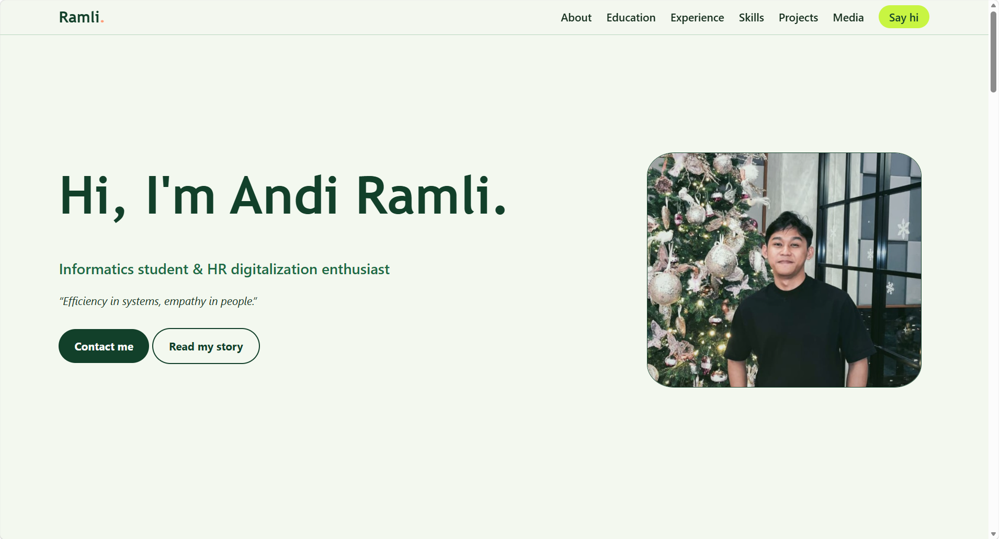
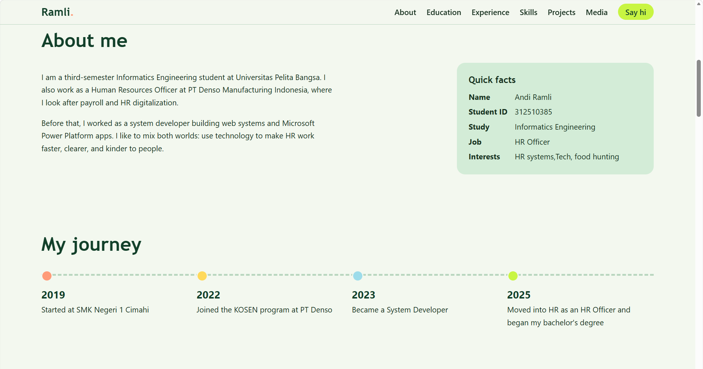
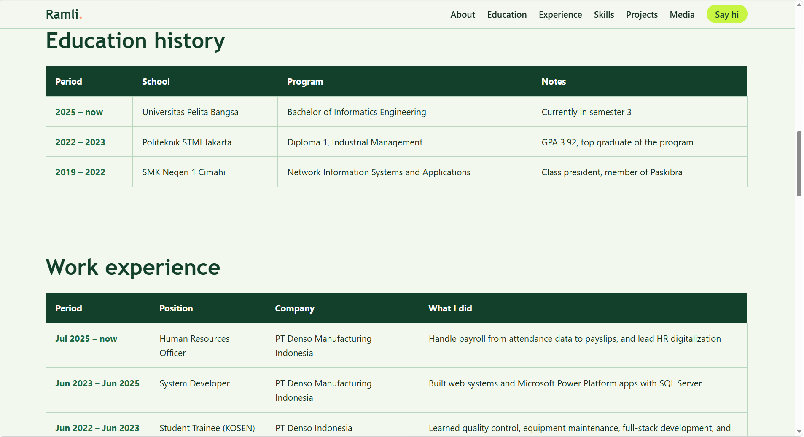
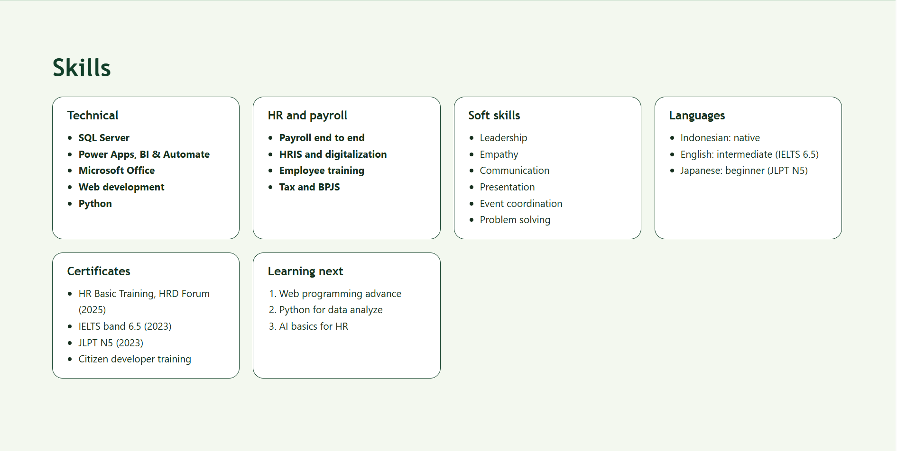
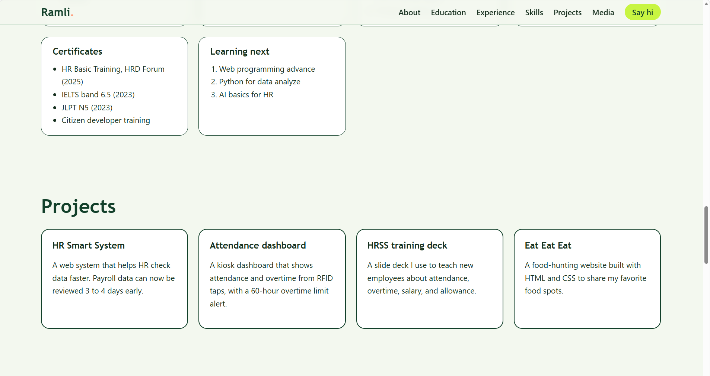
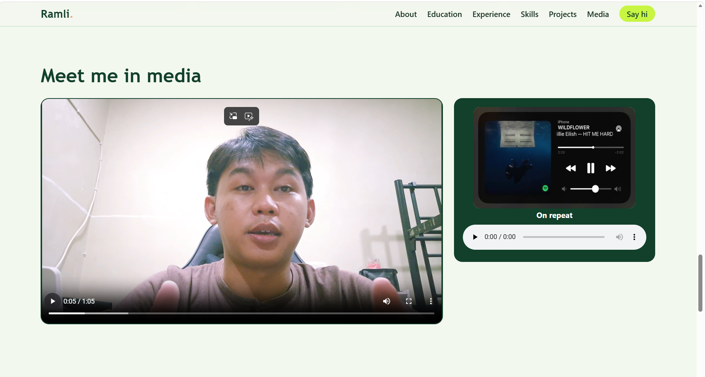
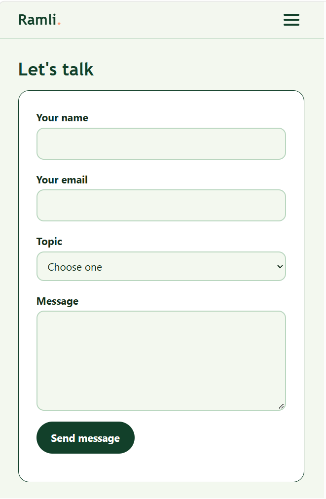

# UTS_Web_312510385_Andiramli
Project ini disusun sebagai bagian dari penyelesaian **Tugas UTS Pemrograman Web**.

## 📝 Laporan Ringkas Proses Pembuatan
### 1. Perancangan Struktur HTML (index.html)
Proses dimulai dengan menyusun struktur halaman menggunakan tag HTML semantik untuk meningkatkan keterbacaan kode dan mempermudah pengelompokan konten.
Bagian utama yang dibuat meliputi:
- Header dan navigasi
- Hero section
- About Me
- Journey Timeline
- Education History
- Work Experience
- Skills
- Projects
- Multimedia
- Contact Form
- Footer
### 2. Pembuatan Layout dan Styling CSS (style.css)
Tahap berikutnya adalah membangun tampilan website menggunakan CSS.
Fitur styling yang diterapkan:
- Penggunaan variabel warna menggunakan `:root`
- Layout responsif menggunakan CSS Grid dan Flexbox
- Desain card untuk skill dan project
- Tabel pendidikan dan pengalaman kerja
- Styling form kontak
- Tampilan multimedia audio dan video
### 3. Penerapan Responsive Design
Agar website dapat digunakan di berbagai ukuran layar, digunakan Media Query:
```css
@media (max-width: 900px)
```
Penyesuaian yang dilakukan:
- Hero section berubah menjadi satu kolom
- Navigation berubah menjadi hamburger menu
- Grid layout menjadi vertikal
- Media section menyesuaikan ukuran layar
### 4. Pengujian dan Evaluasi
Pengujian dilakukan pada beberapa aspek berikut:
- Seluruh menu navigasi dapat berjalan dengan baik.
- Tabel dapat ditampilkan dengan benar pada berbagai ukuran layar.
- Form kontak mampu melakukan validasi input HTML5.
- File audio dan video berjalan sesuai fungsi.
- Layout tetap responsif pada perangkat mobile dan desktop.

<hr>

## Hasil Tampilan 
### 1. Tampilan Utama dan Hero Panel(Desktop)
<br>
<br><br>
### 2. Tampilan Riwayat Pendidikan dan Pengalaman Bekerja
<br>
### 3. Tampilan Skill dan Project
<br>
<br>
### 4. Tampilan Media
<br>
### 5. Tampilan Responsif(Mobile)
<br>

<hr>

[](https://aramli.github.io/UTS_Web_312510385_Andiramli/index.html) → klik untuk lihat hasil praktikum


